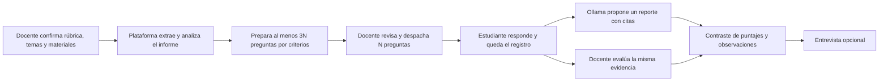

# Flujo de evaluación y calibración

1. En **Parámetros de evaluación**, registra criterios con pesos que sumen 100 y los temas del test. Puedes adjuntar una rúbrica o confirmar sus criterios en el formulario.
2. Vincula los PDF de esa evaluación como **Material de clase** y los recursos comunes como **Material del semestre**. Los documentos se pueden reutilizar entre evaluaciones del mismo curso.
3. Carga y analiza el informe. La configuración vigente se registra con el informe. Con rúbrica confirmada se generan al menos tres candidatas por pregunta del test, agrupadas por criterio. Antes de despachar se verifica la cobertura.
4. El alumno responde el Flash Test. El registro conserva orden, enunciados y respuestas. El panel docente permite vincular preguntas de alternativas con dos repreguntas ya revisadas. Una retoma el concepto ante un error y la otra profundiza ante un acierto. El reporte guarda la rama aplicada.
5. En **Resultados y Citas**, selecciona un Flash Test completado. Genera el reporte con Ollama, registra la revisión docente y compara ambas evaluaciones. Si falta evidencia verificable, el criterio se muestra sin puntaje y queda visible el porcentaje de la rúbrica cubierto.

Para la demostración, presenta un informe sobre un algoritmo o reservas concurrentes. Pide explicar una decisión y luego aplicarla a un caso con una condición distinta. Para el piloto, repite el flujo con un análisis jurídico, un reporte de laboratorio y un diagrama acompañado de texto que explique sus elementos. Los diagramas que no tengan descripción requieren revisión visual docente.

Guarda los criterios como plantilla para reutilizarlos en el curso. Descarga el PDF individual desde Resultados y Citas. Tras registrar el contraste, puedes pedir una reevaluación con la retroalimentación docente y comparar su error medio antes y después. Esa comparación usa el mismo caso; para medir generalización, se requiere un conjunto de casos independientes.
